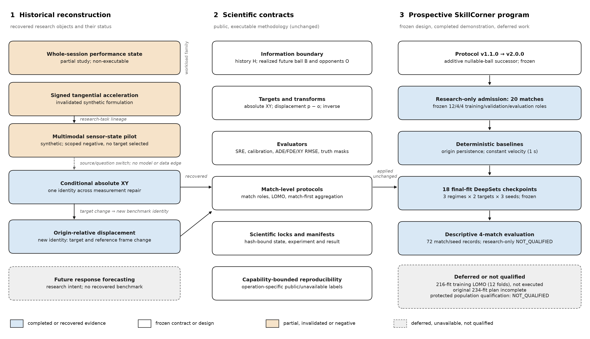
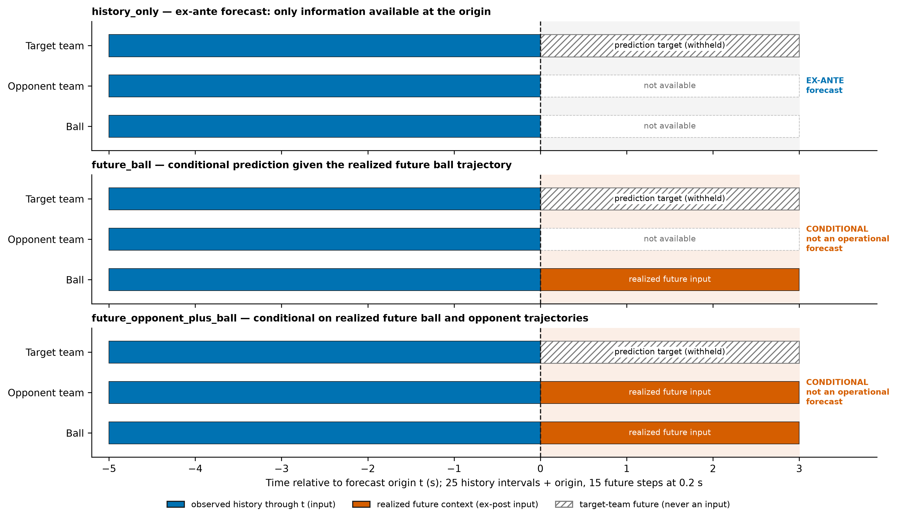
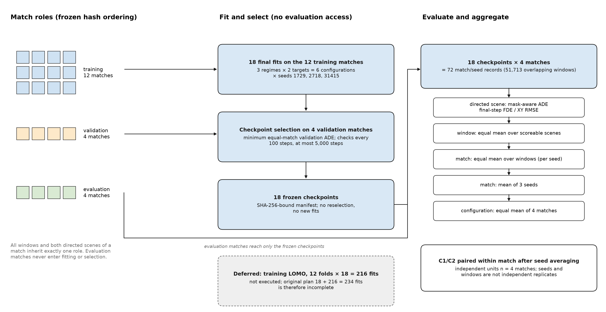
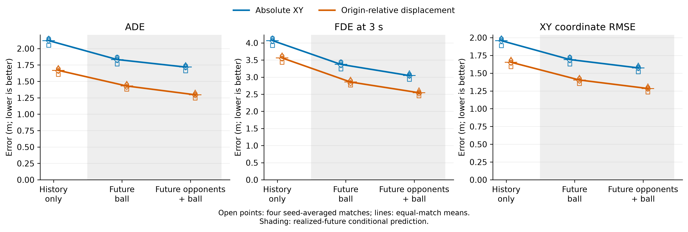
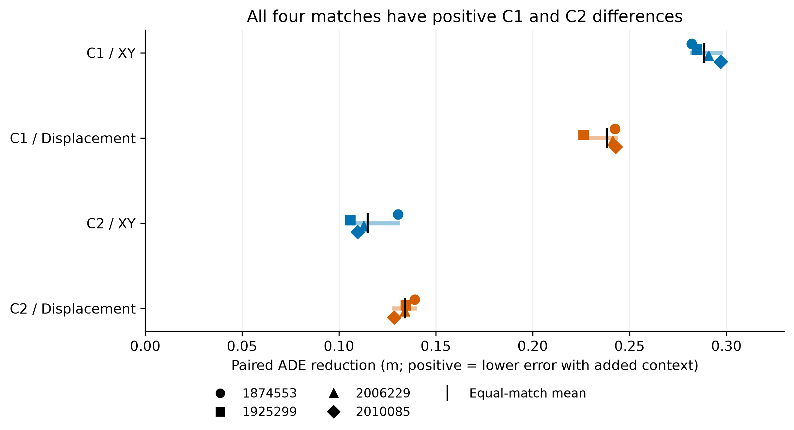
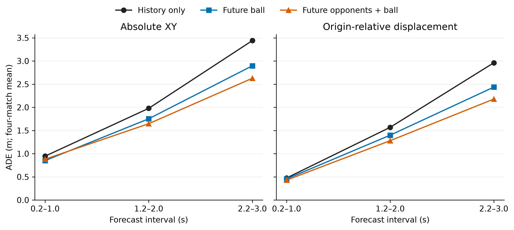

# Paper A scientific evidence: tables, schematics and bounded demonstration

Evidence package for Paper A ([issue 345](https://linear.app/alignerr-cmj/issue/b7126140-1405-43d5-86e4-591c10b99506)), under [parent issue 311](https://linear.app/alignerr-cmj/issue/5a629e4b-1416-40dd-869a-190a7ae3644e). It supplies the tables, schematics and empirical demonstration that the [methods draft](paper-a-methods.md) left as subsequent work, and follows the same evidence convention: every scientific statement links to the contract or authority that supports it.

**Paper A contributes the benchmark methodology, the task specification and the reproducibility framework.** The empirical experiment in §6 is a bounded demonstration that the framework executes end to end on a real public-source cohort. It does not replace the broader empirical analysis planned for Paper B. All prospective results are research-only and `NOT_QUALIFIED`.

| Item | Location | Status in this package |
| --- | --- | --- |
| Table 1. Benchmark/task matrix | [§1](#1-benchmark-and-task-matrix) | New; compiled from the typed research-object contracts and the frozen v2 protocol |
| Figure 1. Benchmark genealogy | [§2](#2-benchmark-genealogy) | New schematic |
| Figure 2. Information boundary | [§3](#3-information-boundary) | New schematic |
| Figure 3 and Table 2. Evaluation design and fit accounting | [§4](#4-evaluation-design) | New schematic and table |
| Table 3. Reproducibility capability matrix | [§5](#5-reproducibility-capability-matrix) | New; extends the methods draft's historical capability table to the prospective study |
| Tables 4–6 and Figures 4–6. Empirical demonstration | [§6](#6-empirical-demonstration) | Values and figures reused unchanged from the [scientific results](res440/results.md) |
| Interpretation, limitations and traceability | [§7](#7-what-the-demonstration-establishes)–[§9](#9-provenance-traceability-and-verification) | New synthesis of the existing findings |

Schematics are rendered from tracked authorities by [`tools/plot_paper_a_schematics.py`](../tools/plot_paper_a_schematics.py). The renderer reads every count from the frozen protocol, plan, checkpoint manifest and public aggregate findings, and checks that they agree before it draws anything. It reads no source data, checkpoints, predictions or private artifacts.

## 1. Benchmark and task matrix

**Table 1.** Supported tasks and recovered research objects. "Information boundary" lists what a model may use at forecast origin *t*: *H* is the scene history through *t*, and *B*⁺ and *O*⁺ are the realized future ball and opponent trajectories over the horizon. Execution status and scientific maturity are separate attributes ([methods §1](paper-a-methods.md#1-research-objects-and-benchmark-identity)).

| Research object | Information boundary | Prediction target | Evaluation metrics | Implementation status |
| --- | --- | --- | --- | --- |
| Whole-session performance state ([contract](../src/fpdbench/benchmarks/workload_performance_state/whole_session_performance_state.py)) | Unknown; not recovered | Unknown; formulas and units not recovered | Unknown | Historical study; `NON_EXECUTABLE`, maturity `PARTIAL`. Not a benchmark |
| Signed tangential acceleration ([contract](../src/fpdbench/benchmarks/workload_performance_state/signed_tangential_acceleration_estimation.py)) | Causal GNSS/inertial history and player-session context; future sensor observations forbidden | Signed horizontal tangential acceleration (m/s²), 10 Hz, synthetic | Global full-row RMSE | Evaluator `PARTIAL`; formulation `INVALIDATED`. Seven diagnostic model bindings |
| Multimodal sensor-state reconstruction ([contract](../src/fpdbench/benchmarks/multimodal_state_estimation/multimodal_sensor_state_reconstruction.py)) | Causal native-rate sensor observations with validity/quality | Candidate clean-state families; none selected | Population-standardized relative error | `PARTIAL`; scoped `NEGATIVE` synthetic pilot. No selected benchmark |
| Future response forecasting ([registry](../src/fpdbench/benchmarks/registry.py)) | Causal history plus ex-ante available future exposure (definition unassigned) | Unassigned | Unassigned | Research intent only; no recovered benchmark, scorer, horizon or population |
| Conditional absolute XY, historical ([contract](../src/fpdbench/benchmarks/conditional_multi_agent_motion_prediction/absolute_position_prediction.py)) | *H*, *B*⁺, *O*⁺ (realized future context); target-team future withheld | 11 target players × 15 steps × XY, normalized by (52.5, 34.0) m; 5 Hz; 5 s history, 3 s horizon | 330-target population SRE; locked calibrated score; physical ADE/FDE/XY RMSE | Contracts, transforms, evaluators and calibration `PUBLIC_EXECUTABLE`; maturity `PARTIAL`. Historical learned inference unavailable |
| Origin-relative displacement, historical ([contract](../src/fpdbench/benchmarks/conditional_multi_agent_motion_prediction/origin_relative_displacement_prediction.py)) | Same as absolute XY | (p − o)/S displacement from the observed origin; separate benchmark identity | Raw 330-target population SRE; physical ADE/FDE/XY RMSE. No calibrated score (calibration not recovered) | Transform, inverse and raw evaluator `PUBLIC_EXECUTABLE`; maturity `PARTIAL`. Corrected aggregate retained; no historical inference |
| Prospective absolute XY v2.0.0 ([protocol](../src/fpdbench/benchmarks/conditional_multi_agent_motion_prediction/prospective_skillcorner_protocol_v2.json)) | Three regimes: `history_only` = *H* (ex-ante); `future_ball` = *H*, *B*⁺; `future_opponent_plus_ball` = *H*, *B*⁺, *O*⁺ (conditional) | Pitch-centred XY in metres for a variable origin-player panel; 26 history samples including the origin; 15 future steps at 0.2 s | ADE (primary), FDE at 3 s, scalar-coordinate XY RMSE; mask-aware with scoreability | Frozen protocol and plan. Research-only descriptive evaluation completed (§6); protected population `NOT_QUALIFIED`; LOMO deferred |
| Prospective displacement v2.0.0 ([protocol](../src/fpdbench/benchmarks/conditional_multi_agent_motion_prediction/prospective_skillcorner_protocol_v2.json)) | Same three regimes | p − o in metres, reconstructed to physical XY for scoring | Same as prospective absolute XY | Same as prospective absolute XY |

The two historical conditional tasks correspond to the richest prospective bundle but keep their own fixed-array contract (25 history steps, 11 targets, 11 opponents and a ball). Their populations and benchmark identities differ from the prospective ones; neither set aliases the other ([methods §7.1](paper-a-methods.md#71-source-authority-versions-and-population)).

**Prospective data and task summary.** The pinned public source is SkillCorner Open Data at commit `4340d274572876239c154c90bc507a9b3250a656` and covers 20 matches. Frames at 10 Hz are subsampled to a 5 Hz grid without interpolation or imputation. Matches have frozen roles of 12 training, 4 validation and 4 evaluation, and the 12 LOMO folds hold out training matches only. The frozen model matrix crosses 3 information regimes with 2 target representations and 3 model classes: origin persistence, one-second constant velocity, and `per_target_context_deepsets_mlp_v1`. The evaluated research admission yielded 51,713 overlapping windows and 103,426 directed scenes across the four evaluation matches. Sources: [source authority](skillcorner-source-authority.md), [protocol v2](../src/fpdbench/benchmarks/conditional_multi_agent_motion_prediction/prospective_skillcorner_protocol_v2.json), [plan v2](../src/fpdbench/benchmarks/conditional_multi_agent_motion_prediction/empirical_experiment_plan_v2.json), [findings](res440/findings.json) `windows` and `denominators`.

## 2. Benchmark genealogy

**Figure 1.** Genealogy of FPD Bench. Fill colour encodes evidence status. Left: recovered research objects. The edge from the acceleration formulation to the sensor-state pilot is a research-task lineage, not a benchmark version. The dashed edge into conditional motion marks a change of source and question, with no model or data successor. Absolute XY keeps one identity across its measurement repair, whereas displacement changes target and reference frame and is therefore a new identity. Centre: the scientific contracts recovered from the historical conditional tasks. Right: the prospective program applies those contracts unchanged. The completed steps are the frozen v1.1.0 → v2.0.0 protocol, the research-only admission, the deterministic baselines, the 18 final-fit checkpoints and the four-match descriptive evaluation. Training LOMO, the complete 234-fit plan and protected qualification are deferred or not qualified. [PDF](paper-a/genealogy.pdf) · [SVG](paper-a/genealogy.svg). Sources: [transition record](benchmark-transitions.md), [transition graph](../src/fpdbench/benchmarks/transition_graph.py), [protocol v2](prospective-skillcorner-protocol-v2.md), [descriptive protocol](../src/fpdbench/benchmarks/conditional_multi_agent_motion_prediction/res635_post_failure_descriptive_protocol_v1.json).

Historical reconstruction recovered contracts, evaluators and evidence-bound records. It did not recover a successful benchmark lineage: three of the four families yielded no valid benchmark, and the two recovered conditional-motion benchmarks remain at maturity `PARTIAL`. Paper A reports those outcomes as findings and does not hide them.

## 3. Information boundary

**Figure 2.** Information boundary at forecast origin *t* (dashed line). Each panel shows one frozen regime, using the `model_visible_features` and `future_context_features` of [protocol v2](../src/fpdbench/benchmarks/conditional_multi_agent_motion_prediction/prospective_skillcorner_protocol_v2.json). Only `history_only` is an ex-ante forecast. `future_ball` and `future_opponent_plus_ball` condition on realized future trajectories, which are not available at time *t*. These two regimes measure apparent predictability given that information and are not operational forecasts. In every regime the target-team future is the prediction target and is never an input. Truth masks, membership, eligibility, phase/event/possession labels, detection attribution, absolute match clock and identity encodings are also excluded from model inputs ([methods §3](paper-a-methods.md#3-information-boundary-formalism)). [PDF](paper-a/information-boundary.pdf) · [SVG](paper-a/information-boundary.svg).

Consequently, only the history-only learned cells can be compared with the deterministic baselines as forecasts. Both baselines use target-player history alone and are regime-invariant.

## 4. Evaluation design

**Figure 3.** Evaluation design of the completed descriptive study. Matches are assigned to roles by a frozen hash ordering, and every window and directed scene inherits its match's role. The 18 final fits were trained on the 12 training matches: 3 regimes × 2 targets × seeds 1729, 2718 and 31415. Checkpoints were selected by validation ADE on the 4 validation matches and then frozen under a SHA-256-bound manifest. Evaluation matches reached only those frozen checkpoints. Scores are averaged within directed scene, window and match, then over three seeds within each match, then equally over the four matches. The C1 and C2 contrasts are paired within match. [PDF](paper-a/evaluation-design.pdf) · [SVG](paper-a/evaluation-design.svg). Sources: [checkpoint manifest](../src/fpdbench/benchmarks/conditional_multi_agent_motion_prediction/res593_checkpoint_manifest_v1.json) (all 18 entries share the training and validation match lists), [plan v2](../src/fpdbench/benchmarks/conditional_multi_agent_motion_prediction/empirical_experiment_plan_v2.json), [aggregation contract](res440/results.md#methods-provenance-and-reuse).

**Table 2.** Planned, deferred and completed learned fits.

| Design | Learned fits | Status |
| --- | ---: | --- |
| Original frozen v2 plan: 18 final fits + 12 LOMO folds × 18 | 234 | Not completed. This study does not complete the original design |
| Training LOMO: 12 folds × 6 configurations × 3 seeds | 216 | Deferred; not executed. No LOMO result exists |
| Completed descriptive study: 18 frozen final-fit checkpoints × 4 evaluation matches | 18 checkpoints, 72 match/seed records | Completed under the separately authorized post-failure descriptive route; no new fits or reselection |

The completed study is not an untouched confirmatory evaluation. An earlier one-shot scoring attempt was interrupted after scoring had started. It produced no committed, recovered or analyst-observed learned result, and the study was then carried out under a separately authorized descriptive protocol ([results](res440/results.md#interpretation-and-limitations), [descriptive protocol](../src/fpdbench/benchmarks/conditional_multi_agent_motion_prediction/res635_post_failure_descriptive_protocol_v1.json)). The amendment also discloses that validation results, the checkpoint-selection criterion, were observed before it was written.

## 5. Reproducibility capability matrix

**Table 3.** Reproducibility capability by operation. Historical labels come from `CAPABILITY_MATRIX` in [reproducibility.py](../src/fpdbench/reproducibility.py). Prospective entries follow the [rights policy](data-rights.md) and the [results release boundary](res440/results.md#methods-provenance-and-reuse).

| Operation | Class | What a third party can do |
| --- | --- | --- |
| Target transforms and inversion; information-boundary validation; SRE, calibrated score and ADE/FDE/XY RMSE kernels; protocol, scientific-lock and result-manifest hashing | **Publicly reproducible** (`PUBLIC_EXECUTABLE`) | Execute from the public checkout using analytic or synthetic inputs |
| Historical fixture/population metadata, result records, output hashes and checkpoint identifiers | **Publicly reproducible** (`PUBLIC_VERIFIABLE`) | Verify references and counts. This does not provide prediction or checkpoint bytes |
| Prospective protocol, plan and checkpoint-manifest identities; role assignment; fit accounting | **Publicly reproducible** | Re-derive the hashes and the counts in Figures 1 and 3 from tracked JSON |
| Every table and figure in this package, rendered from public aggregates | **Publicly reproducible** | Rerun [`plot_res440.py`](../tools/plot_res440.py) and [`plot_paper_a_schematics.py`](../tools/plot_paper_a_schematics.py) and check the tables against [findings.json](res440/findings.json) |
| Source acquisition from the pinned public SkillCorner commit | **Publicly reproducible** (acquisition only) | Obtain the source from SkillCorner directly. FPD does not mirror source rows |
| Row-level derivatives: windows, panels, truth masks, predictions | **Rights-restricted** | Not redistributed under the current policy, which allows aggregates and non-reconstructive figures only |
| 18 learned checkpoints, the match/seed result package, sealed receipts and the execution ledger | **Rights-restricted / owner-private** | Only SHA-256 identities are public. [`analyze_res440.py`](../tools/analyze_res440.py) needs the private package to recompute aggregates |
| Canonical registry evidence resolution | **Rights-restricted** (`LOCAL_EVIDENCE_VERIFIABLE`) | Resolvable only where the documented registry boundary is available |
| Historical source-to-fixture regeneration, historical checkpoint loading and learned inference | **Unavailable** (`UNAVAILABLE_PUBLIC_ARTIFACT`) | Not possible from public artifacts |
| Historical private qualification truth (J03WMX) | **Unavailable** (`FORBIDDEN_PRIVATE_TRUTH`) | Never evaluated; no private result exists |
| Displacement calibration and calibrated displacement score | **Unavailable** | Not recovered and not inferred from the absolute-XY lock |
| Protected prospective population qualification | **Unqualified** (`NOT_QUALIFIED`) | No qualification PASS exists; prospective results are research-only |
| 216-fit training LOMO and the complete 234-fit study | **Unavailable** (not executed) | No result exists to reproduce |

Hash agreement establishes content identity, not scientific validity. Public synthetic checks establish software behaviour, not football accuracy ([methods §6](paper-a-methods.md#6-scientific-locks-provenance-and-capability-bounded-reproducibility)).

## 6. Empirical demonstration

All values below are reused unchanged from the [scientific results](res440/results.md) and [scientific tables](res440/tables.md), at the four-decimal precision of [findings.json](res440/findings.json). The values are in metres and are equal-match means over the 4 evaluation matches, after averaging 3 seeds within each match. SDs are descriptive spreads across the four match means, not uncertainty estimates.

**Table 4.** Physical error for the six learned configurations.

| Information regime | Target | ADE | FDE at 3 s | XY RMSE |
| --- | --- | ---: | ---: | ---: |
| `history_only` (ex-ante) | Absolute XY | 2.1216 | 4.0672 | 1.9570 |
| `history_only` (ex-ante) | Displacement | 1.6680 | 3.5601 | 1.6537 |
| `future_ball` (conditional) | Absolute XY | 1.8330 | 3.3712 | 1.6918 |
| `future_ball` (conditional) | Displacement | 1.4298 | 2.8572 | 1.4041 |
| `future_opponent_plus_ball` (conditional) | Absolute XY | 1.7182 | 3.0447 | 1.5744 |
| `future_opponent_plus_ball` (conditional) | Displacement | 1.2958 | 2.5438 | 1.2843 |

Displacement had lower ADE, FDE and XY RMSE than absolute XY in all six regime pairings, and the ordering held in each match after seed averaging. The absolute-minus-displacement ADE gaps were 0.4536, 0.4032 and 0.4224 m in regime order. Match SDs are given in [scientific tables §1](res440/tables.md#1-physical-trajectory-error).

**Table 5.** History-only forecasts compared with the frozen deterministic baselines.

| History-only system | ADE | FDE | XY RMSE | ADE reduction vs constant velocity |
| --- | ---: | ---: | ---: | ---: |
| Origin persistence | 3.5219 | 6.3739 | 3.0952 | — |
| Constant velocity, 1 s | 2.2433 | 4.9257 | 2.2384 | — |
| DeepSets, absolute XY | 2.1216 | 4.0672 | 1.9570 | 0.1217 m (5.4%) |
| DeepSets, displacement | 1.6680 | 3.5601 | 1.6537 | 0.5753 m (25.6%) |

Baselines and learned cells share the matches, research admission, horizon, truth mask and aggregation hierarchy. Each baseline mean averages four-decimal published match values and therefore carries a rounding bound of 0.00005 m. The learned models use broader scene history than the target-only kinematic baselines, so this is a comparison of systems, not an isolated architecture effect.

**Table 6.** The four prespecified paired ADE contrasts. C1 is `history_only` − `future_ball` and C2 is `future_ball` − `future_opponent_plus_ball`. Positive values mean lower ADE when realized context is added.

| Contrast | Target | 1874553 | 1925299 | 2006229 | 2010085 | Mean |
| --- | --- | ---: | ---: | ---: | ---: | ---: |
| C1 | Absolute XY | 0.2820 | 0.2847 | 0.2908 | 0.2970 | 0.2886 |
| C1 | Displacement | 0.2425 | 0.2263 | 0.2412 | 0.2428 | 0.2382 |
| C2 | Absolute XY | 0.1305 | 0.1059 | 0.1129 | 0.1096 | 0.1147 |
| C2 | Displacement | 0.1390 | 0.1344 | 0.1340 | 0.1284 | 0.1339 |

All 16 match-level differences are positive. Descriptive delete-one-match ranges are in [scientific tables §2](res440/tables.md#2-prespecified-paired-ade-contrasts); they are neither LOMO evaluations nor confidence intervals.

**Horizon reversal.** Error increased from the early to the late interval in every configuration. Adding realized future opponents was not, however, uniformly beneficial. For absolute XY in the early interval (0.2–1.0 s), `future_opponent_plus_ball` ADE was 0.8810 m against 0.8501 m for `future_ball`, a local reversal of 0.0309 m, even though overall C2 was positive. Displacement showed no such reversal: early-interval ADE was 0.4744, 0.4545 and 0.4291 m across the three regimes ([scientific tables §4](res440/tables.md#4-predeclared-horizon-and-target-quality-ade)).

The existing scientific-results figures are reused rather than redrawn, because they already display these quantities at match resolution.

**Figure 4.** ADE, FDE and XY RMSE by regime and target. Open symbols are seed-averaged matches and connected marks are equal-match means; shading marks the conditional regimes. [PDF](res440/errors.pdf) · [SVG](res440/errors.svg).

**Figure 5.** The four C1/C2 contrasts. Symbols are individual match differences and ticks are equal-match means. [PDF](res440/contrasts.pdf) · [SVG](res440/contrasts.svg).

**Figure 6.** Equal-match ADE across the early, middle and late intervals, including the early absolute-XY C2 reversal. [PDF](res440/horizon.pdf) · [SVG](res440/horizon.svg).

## 7. What the demonstration establishes

- **The framework runs end to end on a real cohort.** On a pinned public-source population, the frozen protocol, information boundaries, masks, scoring hierarchy, match-first aggregation and provenance binding produced a complete inventory: 18 checkpoints × 4 matches = 72 verified records with matching denominators. This is the demonstration's primary role in Paper A.
- **The history-only forecasts outperformed constant velocity on these matches.** History-only displacement reached 1.6680 m ADE against 2.2433 m for constant velocity, a descriptive reduction of 0.5753 m (25.6%). Absolute XY gave a smaller reduction of 0.1217 m (5.4%). Both learned encodings improved all three metrics in every match.
- **Target representation mattered for these fitted systems.** Displacement had lower error than absolute XY in all six configurations, every match and all three metrics. Its within-match seed sensitivity was also smaller ([results](res440/results.md#match-and-horizon-variability-qualify-the-overall-pattern), [scientific tables §5](res440/tables.md#5-algorithmic-seed-sensitivity-separate-from-match-dispersion)).
- **Realized context was associated with lower overall ADE in every evaluation match.** Each of the four C1/C2 contrasts was positive in all four matches. The effect was not uniform across the horizon, as the early-horizon absolute-XY reversal of C2 shows.
- **The reporting contract held.** Every result is tied to the four matches as the independent unit, seeds are kept separate from match dispersion, and the deviations from the original design are disclosed.

## 8. What it cannot establish

- **No inference beyond four matches.** The independent unit is the match, and n = 4. The 51,713 windows overlap and are not independent samples; nor are the 72 records or the 3 seeds. The package reports no significance tests, p-values or confidence intervals, and no SD is presented as uncertainty.
- **No generalization.** The results do not establish performance in other matches, leagues, seasons, teams, providers or tracking modalities, nor representativeness of all football situations.
- **No operational forecasting from conditional regimes.** `future_ball` and `future_opponent_plus_ball` use trajectories that are unavailable at the forecast origin. C1 and C2 measure apparent predictability given realized context. They do not show the gain a deployed system would obtain from forecasting ball or opponent trajectories, because no upstream forecast and its errors were evaluated.
- **No causal claims.** The contrasts compare separately fitted, validation-selected models. They do not identify the effect of intervening on the ball or on opponents. The displacement advantage describes these fitted systems; it does not isolate a mechanism, and both encodings represent the same physical trajectory.
- **No ground-truth accuracy.** Provider-extrapolated observations make up 6,008,819 of the 17,065,290 scored player-time points (35.2%, counting repeats across overlapping windows). Only 1,343 of 103,426 directed scenes are detected-only. The scores therefore measure agreement with provider tracking, which includes extrapolation, not with independent ground truth.
- **No completed original study.** The original 234-fit plan is incomplete and the 216-fit training LOMO is deferred, so no cross-match generalization estimate from LOMO exists. This study is descriptive and post-failure, not confirmatory.
- **No qualification.** The prospective population remains `NOT_QUALIFIED`. The research admission does not substitute for protected qualification, and no benchmark component in Table 1 is described as independently qualified beyond its stated status.
- **No architecture comparison.** One learned model class was evaluated, and the comparison with kinematic baselines also differs in input breadth.

These limits match the frozen scientific contract ([descriptive protocol](../src/fpdbench/benchmarks/conditional_multi_agent_motion_prediction/res635_post_failure_descriptive_protocol_v1.json)). The broader empirical questions belong to Paper B: whether the patterns hold over more matches, under LOMO, against other architectures and with forecasted rather than realized context.

## 9. Provenance, traceability and verification

| Reported quantity | Authority |
| --- | --- |
| Six-configuration ADE/FDE/XY RMSE | [findings.json](res440/findings.json) `summary` |
| Per-match C1/C2 differences and means | `contrasts` |
| Baseline values and history-only reductions | `history_baseline_comparisons`; [frozen baseline reference](../src/fpdbench/benchmarks/conditional_multi_agent_motion_prediction/res593_baseline_reference_v1.json) |
| Horizon and quality strata | `strata` |
| Windows, scenes, scored points, extrapolated points | `windows`, `denominators` |
| Independent units, records, attempts, classification | `independent_units`, `records`, `attempts`, `classification` |
| Private input, execution, protocol and baseline identities | `provenance` (SHA-256 and commit only) |
| Match roles, regimes, seeds, 18/216/234 fit counts | [protocol v2](../src/fpdbench/benchmarks/conditional_multi_agent_motion_prediction/prospective_skillcorner_protocol_v2.json), [plan v2](../src/fpdbench/benchmarks/conditional_multi_agent_motion_prediction/empirical_experiment_plan_v2.json), [checkpoint manifest](../src/fpdbench/benchmarks/conditional_multi_agent_motion_prediction/res593_checkpoint_manifest_v1.json) |
| Historical capability classes | `CAPABILITY_MATRIX` in [reproducibility.py](../src/fpdbench/reproducibility.py) |

This package used no retraining, inference, source replay or new experiment. It adds no CSV export and publishes no row-level data, checkpoint, prediction, receipt body or player identity. [`test_paper_a_evidence.py`](../tests/unit/test_paper_a_evidence.py) checks Tables 4–6, the baseline reductions, the reversal, the extrapolation share and the fit/role accounting against the authorities above. It also checks that every local link and figure in this document resolves.
