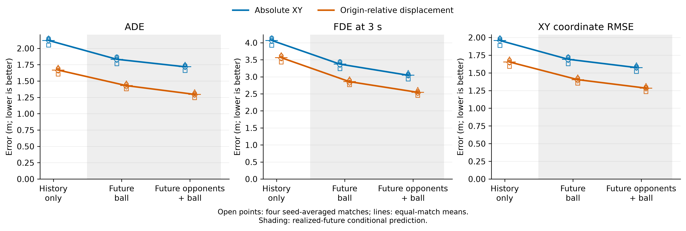
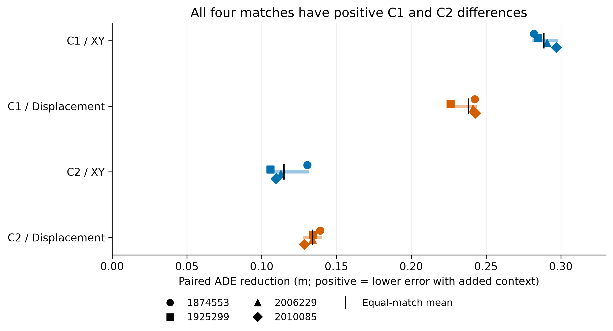
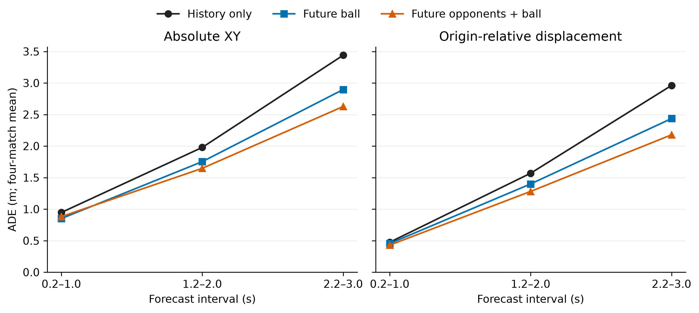

# Football-motion prediction with history and realized future context

RES-440 · 17 November 2026 · **Research-only; `NOT_QUALIFIED`**

## Executive summary

On the four fixed evaluation matches, the frozen DeepSets models had lower error with origin-relative displacement targets than with absolute XY targets in every information regime. History-only displacement achieved **1.6680 m ADE**, compared with **2.2433 m** for constant velocity: a **0.5753 m (25.6%)** descriptive reduction. History-only absolute XY achieved 2.1216 m ADE, a smaller 0.1217 m (5.4%) reduction. These observations concern this cohort and these checkpoints. [1, 2]

Realized future ball context was associated with lower ADE by **0.2886 m** for absolute XY and **0.2382 m** for displacement. Adding realized future opponent trajectories reduced ADE by a further **0.1147 m** and **0.1339 m**, respectively. All four matches had positive differences in each prespecified contrast. These conditional tasks use observations unavailable at the forecast origin; their lower errors do not establish deployable forecasting skill or causal effects. [1]

The independent unit remains **four matches**, despite 51,713 overlapping windows and 72 learned match/seed records. No significance tests, confidence intervals, or generalization claims are made. [1, 3]

## Displacement targets had lower physical error in every regime

| Information available | Target | ADE (m) | FDE at 3 s (m) | XY RMSE (m) |
| --- | --- | ---: | ---: | ---: |
| History only | Absolute XY | 2.1216 | 4.0672 | 1.9570 |
| History only | Displacement | 1.6680 | 3.5601 | 1.6537 |
| History + realized future ball | Absolute XY | 1.8330 | 3.3712 | 1.6918 |
| History + realized future ball | Displacement | 1.4298 | 2.8572 | 1.4041 |
| History + realized future opponents and ball | Absolute XY | 1.7182 | 3.0447 | 1.5744 |
| History + realized future opponents and ball | Displacement | 1.2958 | 2.5438 | 1.2843 |

Each entry averages three seeds within match, then matches equally. Both target encodings are scored in physical absolute XY after displacement reconstruction. Source: [1]; descriptive SDs: [tables](tables.md#1-physical-trajectory-error); full precision: [machine-readable results](findings.json).

The absolute-minus-displacement ADE gaps were 0.4536 m (21.4%) for history only, 0.4032 m (22.0%) for future ball, and 0.4224 m (24.6%) for future opponents plus ball; percentages use absolute-XY ADE as denominator. Corresponding FDE gaps were 0.5071, 0.5140, and 0.5009 m. The displacement ordering held in every match for all three metrics after seed averaging. [1]



**Figure 1.** Open symbols are seed-averaged matches; connected marks are equal-match means. Circle = 1874553, square = 1925299, triangle = 2006229, diamond = 2010085. Shading identifies realized-future conditional tasks. Match spread is descriptive, not an uncertainty interval. [PDF](errors.pdf) · [SVG](errors.svg). Source: [1].

This pattern is consistent with displacement encoding being easier for these fitted models to approximate. It does not isolate a causal mechanism: separate fits and validation-selected checkpoints differ across cells. Both encodings represent the same physical trajectory; the gap describes the fitted systems, not an intrinsic difference in physical tasks.

## All four matches had positive C1 and C2 differences

C1 = history-only ADE − future-ball ADE. C2 = future-ball ADE − future-opponent-plus-ball ADE. Differences are paired within match after averaging seeds; positive values mean lower ADE with added realized context. [1, 3]

| Contrast | Target | 1874553 | 1925299 | 2006229 | 2010085 | Mean (m) |
| --- | --- | ---: | ---: | ---: | ---: | ---: |
| C1 | Absolute XY | 0.2820 | 0.2847 | 0.2908 | 0.2970 | 0.2886 |
| C1 | Displacement | 0.2425 | 0.2263 | 0.2412 | 0.2428 | 0.2382 |
| C2 | Absolute XY | 0.1305 | 0.1059 | 0.1129 | 0.1096 | 0.1147 |
| C2 | Displacement | 0.1390 | 0.1344 | 0.1340 | 0.1284 | 0.1339 |

All values are metres. Source: [1]; full precision: [full-precision findings](findings.json).

C1 reductions were 13.6% of history-only ADE for absolute XY and 14.3% for displacement. C2 reductions were 6.3% and 9.4% of future-ball ADE. Descriptive SDs across the paired differences were 0.0067, 0.0080, 0.0109, and 0.0044 m in table order. Deleting one match at a time yielded mean ranges of 0.2858–0.2908, 0.2367–0.2422, 0.1095–0.1177, and 0.1323–0.1358 m. These are descriptive deletion sensitivities, neither retrained LOMO evaluations nor confidence intervals. [1]



**Figure 2.** Symbols show individual paired differences; black ticks show equal-match means. Colored segments span observed differences. [PDF](contrasts.pdf) · [SVG](contrasts.svg). Source: [1].

The combined history-to-full-context ADE reduction was 0.4034 m (19.0%) for absolute XY and 0.3722 m (22.3%) for displacement. This measures apparent predictability when supplied with realized future trajectories. It does not estimate gains from an upstream ball/opponent forecasting system whose errors were not evaluated. [1]

## History-only learned models improved on comparable deterministic references

The frozen persistence and one-second constant-velocity references share the four matches, research admission, 15-step/3-second horizon, physical truth mask, and scene/window/match aggregation. Receipt denominators match the baseline reference exactly. Both deterministic models consume only history and yield identical physical predictions under either target encoding. Direct forecasting comparisons below therefore use only learned history-only cells. The learned models also consume broader historical context than the target-only kinematic baselines: this is a system comparison, not an isolated architecture effect. [1–3]

| History-only system | ADE (m) | FDE (m) | XY RMSE (m) |
| --- | ---: | ---: | ---: |
| Origin persistence | 3.5219 | 6.3739 | 3.0952 |
| Constant velocity, 1 s | 2.2433 | 4.9257 | 2.2384 |
| DeepSets, absolute XY | 2.1216 | 4.0672 | 1.9570 |
| DeepSets, displacement | 1.6680 | 3.5601 | 1.6537 |

Baseline entries average the published four-decimal **match** values rather than separately rounded role summaries. Source: [1, 2].

Relative to constant velocity, displacement reduced FDE by 1.3656 m (27.7%) and coordinate RMSE by 0.5847 m (26.1%). Absolute XY reduced them by 0.8585 m (17.4%) and 0.2813 m (12.6%). Both learned encodings improved all three metrics in every match. Against persistence, ADE reductions were 1.4003 m for absolute XY and 1.8538 m for displacement. Baseline rounding contributes at most 0.00005 m to each mean difference. No deterministic inference was rerun. [1, 2]

## Match and horizon variability qualify the overall pattern

History-only ADE ranged from 2.0493 to 2.1629 m for absolute XY and 1.6047 to 1.7149 m for displacement. With full context, ranges were 1.6586–1.7592 and 1.2439–1.3397 m. Match 1925299 had the lowest seed-averaged error in every combination and metric; match 2006229 had the highest. This describes four observations, not broader match variability. [1]

Algorithmic sensitivity was also smaller for displacement in these fits. The mean within-match three-seed ADE SD was 0.0657 / 0.0757 / 0.0950 m for absolute XY and 0.0084 / 0.0147 / 0.0053 m for displacement, in history/ball/opponents-plus-ball order. The largest seed range within any match was 0.1993 m for absolute XY and 0.0337 m for displacement across the six cells. These describe the three frozen seeds; they are separate from between-match dispersion and do not enlarge the independent sample. Per-match SDs and all three metrics are in [machine-readable findings](findings.json). [1]



**Figure 3.** Equal-match ADE in three prespecified intervals. Lines connect interval summaries, not continuous-time measurements. [PDF](horizon.pdf) · [SVG](horizon.svg). Source: [1].

Error grew across intervals in every combination. History-only displacement ADE increased from 0.4744 m at 0.2–1.0 s to 2.9607 m at 2.2–3.0 s; full-context displacement increased from 0.4291 to 2.1780 m. Future-ball displacement had a 0.0199 m early reduction versus history, compared with 0.5248 m late. However, absolute-XY future-opponent-plus-ball ADE was **0.8810 m early versus 0.8501 m for future ball**, an increase of 0.0309 m, despite positive overall C2. Added context did not uniformly improve every interval. [1]

## Interpretation and limitations

The supported conclusions are bounded: displacement targets and realized future context were each associated with lower overall physical error for these fitted systems on these matches. Even the lowest-error combination retained 2.5438 m FDE at 3 s. This does not establish tactical understanding, causal response, deployment readiness, or performance in other matches, leagues, seasons, teams, or providers. [1, 3]

Provider-extrapolated targets comprise 6,008,819 of 17,065,290 scored player-time points (35.2%, including repeated observations in overlapping windows). Only 1,343 of 103,426 directed scenes were detected-only; every evaluation window contributed an extrapolation-containing scene. Quality-stratum ADE preserves the six-cell ordering, but detected-only scenes are a small selected subset, with only 66 in match 2010085. These scores do not measure accuracy against independent ground truth. Missing physical targets and quality flags were zero among scored future targets, which does not characterize excluded candidate windows. Quality-stratum windows overlap and are not additive. [1]

The 18 checkpoints represent one model class × six combinations × three seeds, selected using validation data. Seeds are not additional independent matches. This study completes neither the original 234-fit prospective design nor the deferred 216-fit training LOMO campaign. The interrupted RES-594 attempt entered scoring without a committed, recovered, or analyst-observed learned result. The completed study follows the separately authorized post-failure descriptive route; prior exposure precludes presenting it as an untouched confirmatory evaluation. Protected status remains `NOT_QUALIFIED`. [3]

## Methods, provenance, and reuse

The deviations from the original v2 study are explicit:

| Dimension | Original v2 design | Completed descriptive study |
| --- | --- | --- |
| Learned fits | 234 planned fits across three model classes | 18 pre-existing final-fit DeepSets checkpoints; no new fits |
| Training LOMO | 216 planned fits | Deferred and incomplete; no training LOMO |
| Evaluation | Original prospective route | Separately authorized post-failure descriptive route |
| Inference | Original study ambitions | Four fixed-match descriptions; no tests, CIs, or generalization |
| Scientific measurement | Physical XY, frozen masks and hierarchy | Preserved; no endpoint, horizon, match, or contrast changes |

The completed RES-646 study supplied 72 verified records, four sealed receipts, 51,713 windows, and one attempt without continuation. Existing `verify_complete` readback re-authenticated the ledger/result and checked chained receipt seals, source/checkpoint/code/runtime provenance, independent metric-audit agreement, denominators, and the complete ordered cell inventory. This analysis independently recomputed means and contrasts from package records and reconciled them to stored aggregates. It performed no source-stream replay, model deserialization, inference, retraining, or protocol changes. [1]

The frozen scorer averages directed-scene metrics within window, then windows within match. This analysis averages three seed metrics within match and then the four matches equally: configuration score = (1/4) Σ_match [(1/3) Σ_seed score(match, seed)]. Match window counts are 12,363 / 14,018 / 12,501 / 12,831 in contrast-table order; they do not set cross-match weights. ADE is mean Euclidean error; FDE uses the final target at 3 s. Scene XY RMSE is √[Σ(dx²+dy²)/(2N)], then averaged under the same hierarchy. Reported RMSE is not pooled coordinate RMSE or root-mean-squared Euclidean displacement. [1, 3]

SkillCorner Open Data is the research source. Under the repository's [aggregate publication policy](../data-rights.md), this release includes only match/configuration aggregates, non-reconstructive figures, and provenance hashes. Raw packages, receipt bodies, source rows, masks, player identities, predictions, checkpoints, and ledger material remain owner-private.

1. **Analysis evidence:** [findings.json](findings.json) (including match means, paired baseline differences, and strata) and [scientific tables](tables.md). Public provenance records the private input's SHA-256 and execution/result/protocol identities without private paths or receipt bodies.
2. **Deterministic evidence:** [frozen baseline reference](../../src/fpdbench/benchmarks/conditional_multi_agent_motion_prediction/res593_baseline_reference_v1.json), [published baseline results](../res337-deterministic-research-results.md).
3. **Scientific contract:** [machine-readable descriptive protocol](../../src/fpdbench/benchmarks/conditional_multi_agent_motion_prediction/res635_post_failure_descriptive_protocol_v1.json), [RES-646 execution boundary](../res646-execution-boundary.md). Historical proposal-status prose is not the completed execution authority; the authenticated RES-646 completion is.

Reproduce aggregate analysis in the existing frozen research environment:

```sh
.venv/bin/python tools/analyze_res440.py /path/to/owner-private/res440-results.json
.venv/bin/pytest -q tests/unit/test_res440_analysis.py
```

Render from public aggregates with `python tools/plot_res440.py` in an environment with Matplotlib (rendered here with 3.11.2). No plotting dependency is added to the benchmark runtime. Figures are supplied as 300-dpi PNG, SVG, and PDF. CSV/JSON retain full precision; tables round to four decimals.
